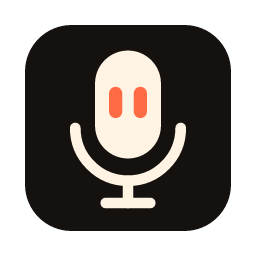
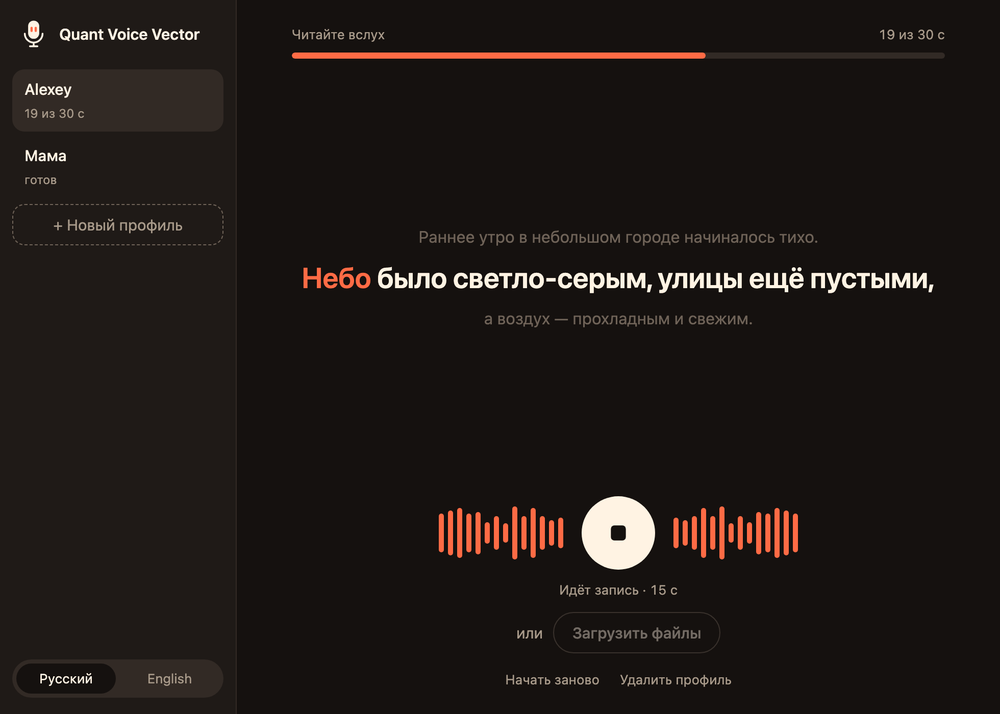
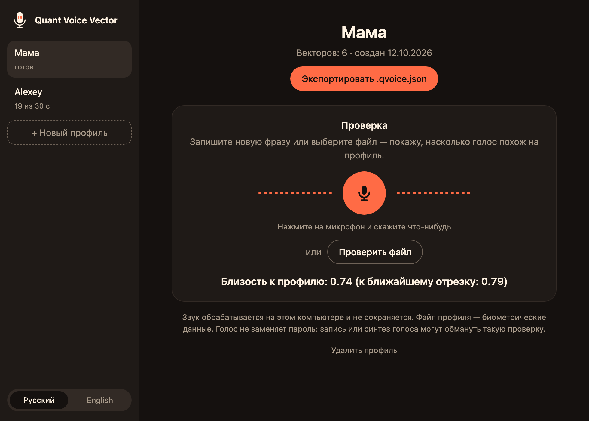
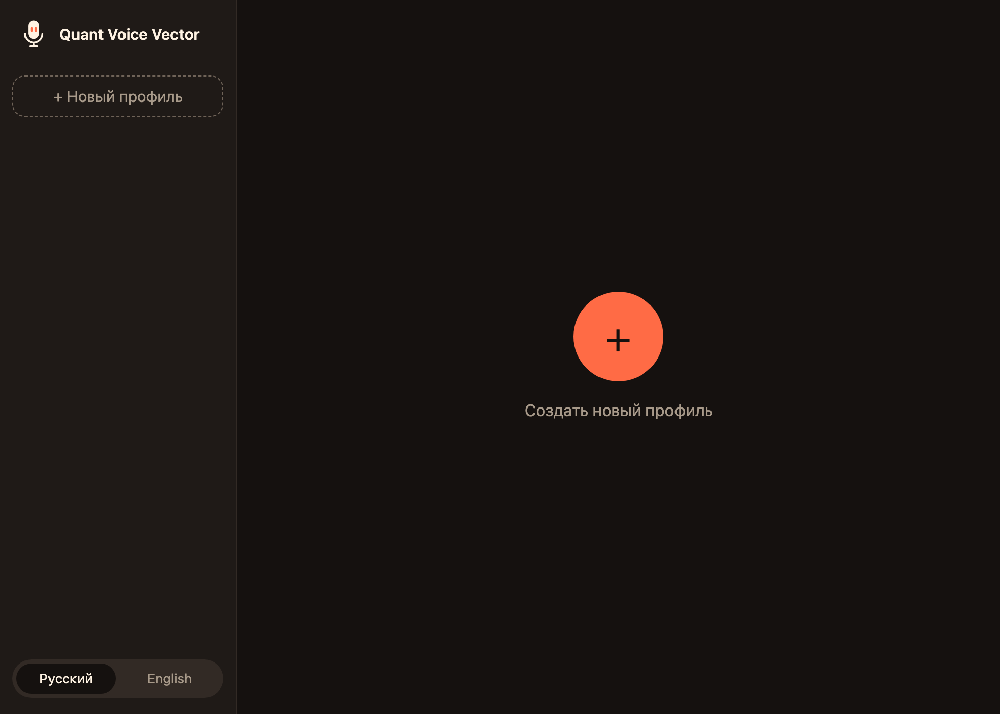
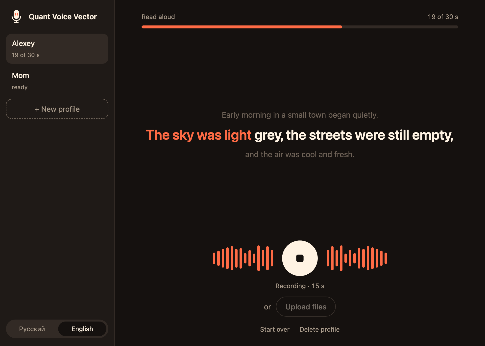

<p align="center">
  
</p>

<h1 align="center">Quant Voice Vector</h1>

<p align="center">
  <b>An open-source desktop app that turns a voice into a voice profile file.</b><br>
  Read a short text aloud or drop in a few recordings, and get a <code>.qvoice.json</code> that lets<br>
  <a href="https://github.com/Quant-Ai-Assistant/Quant-Core">Quant-Core</a> recognize who is speaking. Everything happens on your computer.
</p>

<p align="center">
  
  
  
  
  
  
  
</p>

<p align="center">
  <a href="#features">Features</a> ·
  <a href="#stack">Stack</a> ·
  <a href="#run-on-macos">Run on macOS</a> ·
  <a href="#windows-and-linux">Windows and Linux</a> ·
  <a href="#build-with-an-ai-agent">Build with an agent</a> ·
  <a href="#development">Development</a> ·
  <a href="#documentation">Documentation</a> ·
  <a href="#license">License</a>
</p>

<br>

<table>
  <tr>
    <td width="25%" valign="top">
      <h3>🎙️ Read and record</h3>
      A karaoke-style screen shows what to read, highlights the words as you speak and draws your voice live. Thirty seconds of speech is enough.
    </td>
    <td width="25%" valign="top">
      <h3>🔒 Stays on your computer</h3>
      No account, no server, no network calls. Audio is processed in memory and never saved; only the finished profile is written to disk.
    </td>
    <td width="25%" valign="top">
      <h3>📄 One portable file</h3>
      A profile is a plain JSON file with speaker vectors and the checksum of the model that made them, described by a JSON Schema.
    </td>
    <td width="25%" valign="top">
      <h3>🤖 Agent-ready</h3>
      The repo ships its own agent instructions, a mandatory code style and a one-command quality gate, so an AI agent can build and extend it from a single prompt.
    </td>
  </tr>
</table>

<br>

<table>
  <tr>
    <td width="50%"></td>
    <td width="50%"></td>
  </tr>
  <tr>
    <td align="center"><sub>Recording</sub></td>
    <td align="center"><sub>Checking a saved profile</sub></td>
  </tr>
  <tr>
    <td width="50%"></td>
    <td width="50%"></td>
  </tr>
  <tr>
    <td align="center"><sub>First launch</sub></td>
    <td align="center"><sub>English interface</sub></td>
  </tr>
</table>

<sub>Screenshots show the dark theme with demo data.</sub>

> [!NOTE]
> The interface and the reading text are available in **Russian and English**. Russian is the default; the switch is at the bottom of the sidebar. The guides come in both languages too: [English](docs/en/) and [Русский](docs/ru/).

> [!WARNING]
> **A voice is not a password.** A recording or a synthetic voice can fool this kind of check. Use voice recognition for convenience ("who is speaking now"), never to protect access. A profile file is biometric data: keep it like a personal document.

## Features

<table>
  <tr>
    <td width="50%" valign="top">
      <h3>Profiles in the sidebar</h3>
      Create a profile with the plus button, name it and start recording. Saved profiles survive a restart; a draft lives until you close the window.
      <br><br>
      See <a href="docs/en/usage.md">using the app</a>.
    </td>
    <td width="50%" valign="top">
      <h3>Microphone or files</h3>
      Record with the microphone, or add files you already have: WAV, MP3, M4A, FLAC, OGG, Opus and WebM, including voice messages from messengers.
      <br><br>
      See <a href="docs/en/usage.md#adding-files">adding files</a>.
    </td>
  </tr>
  <tr>
    <td width="50%" valign="top">
      <h3>Clean speech only</h3>
      Silence and noise are cut out, speech is split into segments, and segments that do not sound like the rest (another person, a cough, music) are dropped.
      <br><br>
      See <a href="docs/en/quant-core.md">how vectors are computed</a>.
    </td>
    <td width="50%" valign="top">
      <h3>Check before you export</h3>
      Record a new phrase or pick a file and see how close it is to the profile, then export the <code>.qvoice.json</code> and load it into Quant-Core.
      <br><br>
      See <a href="docs/en/file-format.md">the file format</a>.
    </td>
  </tr>
</table>

## Stack

- **Core:** Rust. Decoding with Symphonia and libopus, voice activity detection with Silero VAD, speaker vectors with [sherpa-onnx](https://github.com/k2-fsa/sherpa-onnx) and the 3D-Speaker CAM++ model (192 numbers per vector).
- **App:** Tauri 2, microphone capture with cpal. Installers for macOS, Windows and Linux.
- **Interface:** plain HTML, CSS and JavaScript with no build step and no remote resources.
- **Contract:** [`schema/qvoice.v1.schema.json`](schema/qvoice.v1.schema.json), the same schema Quant-Core validates against.
- **Quality:** rustfmt, Clippy and unit tests, run by GitHub Actions on every push and pull request.

## Run on macOS

1. Open [Releases](https://github.com/Quant-Ai-Assistant/Quant-Voice-Vector/releases) and download the `.dmg`: `aarch64` for Apple Silicon (M1 and later), `x64` for Intel.
2. Open the `.dmg` and drag **Quant Voice Vector** into **Applications**.
3. Start the app. macOS will say it "could not verify" the app, because it is not signed with an Apple developer certificate yet. Click **Done**.
4. Open **System Settings → Privacy & Security**, scroll down and click **Open Anyway** next to the message about Quant Voice Vector, then confirm.
5. Allow microphone access when macOS asks.

Step 4 is needed once per version. If you prefer the terminal, this does the same:

```sh
xattr -dr com.apple.quarantine "/Applications/Quant Voice Vector.app"
```

Then create a profile: press **+**, type a name, press the microphone and read the text until the counter reaches 30 seconds, then **Save profile** and **Export .qvoice.json**.

Saved profiles are stored in `~/Library/Application Support/ai.quant.voicevector/profiles`.

## Windows and Linux

| System | File | First launch |
| --- | --- | --- |
| Windows 10 and 11 | `..._x64-setup.exe` | SmartScreen: **More info → Run anyway** |
| Linux | `.AppImage` | `chmod +x` the file, then run it |
| Debian and Ubuntu | `.deb` | `sudo apt install ./<file>.deb` |

Details, data folders and removal are in the [installation guide](docs/en/installation.md).

## Build with an AI agent

Any coding agent that can run shell commands (Claude Code, Codex, Cursor and similar) can build the app from source. Open an empty folder in the agent and paste:

```text
Build Quant Voice Vector on this machine.

1. Clone https://github.com/Quant-Ai-Assistant/Quant-Voice-Vector.git and work inside it.
2. Read AGENTS.md and docs/en/development.md, and follow them exactly.
3. Check that Rust (stable), cmake and Node.js are installed. On Linux also check the
   packages listed in docs/en/development.md. If something is missing, stop and tell me
   what to install.
4. Run ./scripts/fetch-models.sh to download the models and verify their checksums.
5. Run ./scripts/check.sh and make sure every check passes.
6. Build the app for this system: cd app && npx @tauri-apps/cli@2 build
7. Report where the installer is, its size, and anything you skipped.

Do not commit or push anything, do not change the model or the file format, and do not
add network calls.
```

For agents working on the code itself, [`AGENTS.md`](AGENTS.md) and [`CLAUDE.md`](CLAUDE.md) carry the project rules, [`CodeStyle.md`](CodeStyle.md) is the mandatory standard, and `./scripts/check.sh` is the gate that has to pass before a push.

## Development

You need Rust (stable), cmake and Node.js. On macOS:

```sh
brew install rustup cmake node
rustup default stable
```

```sh
git clone https://github.com/Quant-Ai-Assistant/Quant-Voice-Vector.git
cd Quant-Voice-Vector

./scripts/fetch-models.sh                  # download the models, verify checksums
cargo run -p qvv-app                       # run the app from source
./scripts/check.sh                         # formatting, Clippy, tests, syntax checks
cd app && npx @tauri-apps/cli@2 build      # build an installer for this system
```

Where things live:

- **Core:** `crates/qvv-core/src/`, with the pinned models in `model.rs`
- **App and commands:** `app/src/main.rs`, microphone in `app/src/recorder.rs`
- **Interface:** `ui/`, interface strings in `ui/main.js`, reading texts in `ui/texts.js`
- **File format:** `schema/qvoice.v1.schema.json`
- **Release:** `.github/workflows/release.yml`, started by a tag like `v0.1.0`

[`CodeStyle.md`](CodeStyle.md) is mandatory for human developers and AI agents alike. Read it before implementing anything, and cite rule numbers in reviews.

## Documentation

Every guide exists in English ([`docs/en`](docs/en/)) and in Russian ([`docs/ru`](docs/ru/)). The links below lead to the English versions.

| Document | Covers |
| --- | --- |
| [Installation](docs/en/installation.md) | macOS, Windows and Linux, system warnings, data folders, removal |
| [Using the app](docs/en/usage.md) | Profiles, recording, files, saving, checking, export, languages |
| [File format](docs/en/file-format.md) | Every field of `.qvoice.json` version 1 and the rules a reader must check |
| [Quant-Core integration](docs/en/quant-core.md) | What the other side has to repeat so that vectors match |
| [Privacy](docs/en/privacy.md) | What is stored, what never is, and why a voice is not a password |
| [Development](docs/en/development.md) | Requirements, commands, layout, quality gate, releases |

## License

Quant Voice Vector is free software, licensed under the [GNU Affero General Public License v3.0 or later](LICENSE) (AGPL-3.0-or-later).
Copyright (c) 2026 ZeroKJ123 and the Quant Voice Vector contributors.

In plain words:

- **You may** use, study, change, share and even sell it.
- **You must** keep it open: if you distribute it, or run a modified version as a service that other people use over a network, you have to give them the complete source code of your version under the same license.
- **You may not** turn it, or anything built from it, into a closed-source product.

This summary is not a substitute for the license text. The software comes with no warranty.

The installers bundle third-party components under their own licenses:

| Component | License |
| --- | --- |
| [3D-Speaker CAM++ speaker model](https://modelscope.cn/models/iic/speech_campplus_sv_zh_en_16k-common_advanced) | Apache-2.0 |
| [Silero VAD](https://github.com/snakers4/silero-vad) | MIT |
| [sherpa-onnx](https://github.com/k2-fsa/sherpa-onnx) | Apache-2.0 |
| [ONNX Runtime](https://github.com/microsoft/onnxruntime) | MIT |
| [libopus](https://opus-codec.org/license/) | BSD |
| [Symphonia](https://github.com/pdeljanov/Symphonia) | MPL-2.0 |
| [Tauri](https://github.com/tauri-apps/tauri) | Apache-2.0 or MIT |
